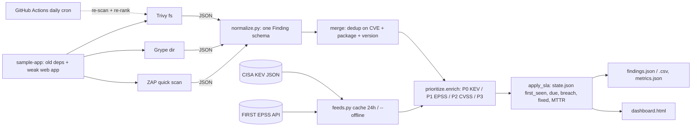

# VulnOps — Trivy + Grype + ZAP → one risk-ranked fix queue (CVSS + EPSS + CISA KEV) with SLA tracking

> **Lab project.** The scan targets in `sample-app/` are **intentionally outdated** (log4j 2.14.1, spring-beans 5.3.17, Django 2.2.0, lodash 4.17.15…) plus a tiny weak stdlib web app for ZAP. All scanner outputs in `scans/` are **real runs I did on 2026-10-11**. KEV and EPSS are fetched live from the public feeds and cached in `feeds/`. 

## Problem
Scanners produce hundreds of findings, and CVSS alone ranks a never-exploited "10.0" alongside Log4Shell. Teams drown, SLAs slip, and the actually-exploited bugs wait in the queue. VulnOps:
1. **Normalises** Trivy, Grype and ZAP JSON into one schema and **dedups across tools** (GHSA→CVE mapping, Maven `group:artifact` vs `artifact`).
2. **Enriches** each CVE with **FIRST EPSS** (probability of exploitation in the next 30 days) and **CISA KEV** (known exploited, including the ransomware flag).
3. **Prioritises** into P0–P3 with SLA due dates, tracks first-seen, fixed and re-opened state across runs, and computes breaches and MTTR.
4. Renders a **static HTML dashboard** plus `findings.csv` and `metrics.json`.

## Architecture


## Priority policy
| Priority | Rule | SLA |
|---|---|---|
| **P0** | in CISA KEV | 7 days |
| **P1** | EPSS ≥ 0.10, or CVSS ≥ 9.0 and EPSS ≥ 0.01 | 15 days |
| **P2** | CVSS ≥ 7.0 | 30 days |
| **P3** | everything else (including ZAP Low/Info) | 90 days |

Within a bucket, findings are sorted by `risk_score = 40·KEV + 40·EPSS + 2·CVSS`. ZAP has no CVSS, so its riskcode maps High→7.5, Medium→5.0, Low→3.0, Info→0. That mapping is an assumption, not CVSS.

## Run
```bash
python3 -m venv .venv && .venv/bin/pip install -r requirements-dev.txt     # stdlib only at runtime
.venv/bin/pytest -q
# re-scan (optional; raw outputs already in scans/)
trivy fs --scanners vuln --format json -o scans/trivy.json sample-app
grype dir:sample-app -o json --file scans/grype.json
python3 sample-app/server.py &  zap.sh -cmd -port 8099 -quickurl http://127.0.0.1:8088/ -quickout $PWD/scans/zap.json
# prioritise (live feeds; add --offline to use feeds/ cache only)
python3 -m vulnops.cli --trivy scans/trivy.json --grype scans/grype.json --zap scans/zap.json -o results --state results/state.json
xdg-open results/dashboard.html
docker build -t vulnops . && docker run --rm -v "$PWD/out:/app/out" vulnops
```

## Results (actual run on the box, 2026-10-11 IST)
Feeds: **CISA KEV catalog 2026.10.08 (1,739 CVEs)** and **EPSS scores dated 2026-10-10**, fetched live. Tools: Trivy 0.75.0, Grype 0.120.1, ZAP 2.16.1.

**Run 1: initial scan** (`results/run1_2026-10-11/`)

| Metric | Value |
|---|---|
| Raw findings | 355 (Trivy 174, Grype 170, ZAP 11) |
| After cross-tool dedup | **185** (170 duplicates removed; 170 found by both Trivy and Grype, 4 by Trivy only, 11 ZAP) |
| With a CVE / EPSS-scored | 171 / 171 |
| By priority | **P0 4 · P1 26 · P2 79 · P3 76** |
| KEV findings | 4 (2 flagged *known ransomware use*): CVE-2021-44228 and CVE-2021-45046 (log4j-core 2.14.1), CVE-2022-22965 Spring4Shell (spring-beans 5.3.17), CVE-2023-4863 (Pillow 6.2.0, libwebp) |
| KEV in top-20, **CVSS-only ordering** | 2 / 4 |
| KEV in top-20, **risk-based ordering** | **4 / 4** |
| EPSS ≥ 0.1 in top-20: CVSS-only vs risk-based | 7 vs **16** |
| "Fix now" workload: CVSS ≥ 7 vs P0+P1 | 107 vs **30** (−72%) |
| Pipeline runtime (feeds cached) | 0.05 s |

Under CVSS-only ordering, two axios CVEs (CVSS 10.0 and 9.9, EPSS 0.006 and 0.012) rank above Spring4Shell (CVSS 9.8, EPSS 0.996, in KEV).

ZAP (11 alerts) found missing CSP and anti-clickjacking headers, cookies without HttpOnly/SameSite, `Server`/`X-Powered-By` version leaks, cross-domain JS and 4 "hidden file" hits. It did **not** report the deliberately reflected `?name=` parameter as XSS in quick-scan mode.

**Run 2: after patching** (`results/`). I upgraded log4j to 2.17.1, spring-beans to 5.3.18, lodash to 4.17.21 and minimist to 1.2.6 in `sample-app-v2/`, then re-scanned for real. **The run date was simulated as 2026-10-25** (`--today`) to exercise SLA ageing.
- 21 findings closed as *fixed* (MTTR 14.0 days). 174 still open.
- P0 1 · P1 22 · P2 77 · P3 74.
- **1 SLA breach:** CVE-2023-4863 in Pillow is in KEV, so the SLA is 7 days, and it is still open after 14 days. 21 more are due within 3 days.

## Limitations
- One small lab target. The numbers show the method, not an organisation's real backlog.
- No reachability analysis: a vulnerable function may never be called. No asset criticality or internet exposure factor yet.
- Dedup key is CVE + normalised package + version. Different ecosystems' names for the same component (OS vs language packages) won't merge.
- The ZAP riskcode→CVSS mapping is my assumption. ZAP ran a single quick scan (spider + active) against localhost with no authentication or AJAX spider.
- EPSS is a 30-day probability and changes daily, so priorities drift. That's why CI is on a daily cron and `state.json` keeps the first-seen date.
- Not integrated with DefectDojo or Grafana yet. The dashboard is static HTML, and `findings.csv`/`metrics.json` are the integration points.
- The 2026-10-25 run uses a simulated date. Dockerfile and CI are written but not executed here (no Docker daemon on the box, and nothing pushed). The CI ZAP step uses `zap-baseline.py` (passive) instead of the quick scan I ran locally.

## Sources
- CISA Known Exploited Vulnerabilities catalog (JSON feed): https://www.cisa.gov/known-exploited-vulnerabilities-catalog · https://www.cisa.gov/sites/default/files/feeds/known_exploited_vulnerabilities.json
- CISA BOD 22-01 (KEV remediation deadlines): https://www.cisa.gov/news-events/directives/bod-22-01-reducing-significant-risk-known-exploited-vulnerabilities
- FIRST EPSS and API: https://www.first.org/epss/ · https://www.first.org/epss/api
- FIRST CVSS v3.1 spec: https://www.first.org/cvss/v3.1/specification-document
- Trivy JSON: https://trivy.dev/latest/docs/configuration/reporting/ · Grype: https://github.com/anchore/grype · ZAP: https://www.zaproxy.org/docs/
- Inspiration: https://github.com/hautestacky/defectdojo-exporter, https://github.com/madhav-dhungana/Dojo-CTI

## Related work

This is my own implementation. Ideas came from [hautestacky/defectdojo-exporter](https://github.com/hautestacky/defectdojo-exporter) and [madhav-dhungana/Dojo-CTI](https://github.com/madhav-dhungana/Dojo-CTI).
